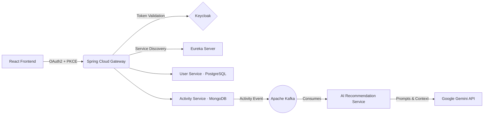

<!-- ═══════════════════════════════════════════════════════════════
     Arjun Khade · GitHub Profile README
     Repository: github.com/ArjunKhade/ArjunKhade
     Palette: lavender #7F7FD5 · sky #86A8E7 · mint #5EEAD4
     ═══════════════════════════════════════════════════════════════ -->

<div align="center">

<!-- Animated gradient wave header -->


<!-- Animated typing text -->
<a href="https://modern-portfolio-eight-tawny.vercel.app/">
  
</a>

<br/>

<!-- Quick links -->
<p align="center">
  <a href="https://modern-portfolio-eight-tawny.vercel.app/" target="_blank"></a>
  <a href="https://www.linkedin.com/in/arjun-khade-ba825017b/" target="_blank"></a>
  <a href="mailto:khadearjun@gmail.com"></a>
  <a href="https://github.com/ArjunKhade" target="_blank"></a>
</p>

<!-- Status bar -->
<p align="center">
  
  
  
  
</p>

</div>

---

## 👋 About Me

```typescript
const arjunKhade = {
  role            : "Full Stack Software Developer",
  location        : "Pune, India",
  experienceYears : 3.9,
  domain          : ["Enterprise Healthcare (EHR / EVV)", "IDD & Behavioral Health", "Cloud SaaS"],
  frontend        : ["Angular (v13 → v21)", "TypeScript", "RxJS", "NgRx", "Signals", "React"],
  backend         : ["Java 17", "Spring Boot", "Spring Cloud", "Spring Security", "JPA", "Kafka"],
  architecture    : ["Microservices", "Offline-First PWAs", "Zoneless Angular", "OAuth2 / PKCE", "REST APIs"],
  currentFocus    : "Event-driven AI microservices & high-performance reactive web apps",
  funFact         : "I enjoy turning slow, legacy screens into fast, delightful ones ⚡"
};
```

---

## 🛠️ Tech Stack & Tools

<div align="center">

**Frontend**


**Backend & Messaging**


**Databases**


**Cloud, DevOps & Tools**


</div>

---

## 🏆 Engineering Impact

<div align="center">

| Metric | Initiative | Impact |
| :--- | :--- | :--- |
| 🚀 **`v13 → v21`** | **Zero-Downtime Angular Migration** | Led end-to-end migration of production healthcare apps to **Standalone Components**, **Signals**, built-in **Control Flow** and **Zoneless** change detection. |
| ⚡ **`35–45%`** | **Bundle & Load Time Reduction** | Route-level code splitting, lazy loading, `OnPush`, `trackBy` and SVG/WebP optimization, cutting page load times by **40%**. |
| 📡 **`40% less`** | **Redundant Network Traffic** | Reactive API layer using RxJS caching, debouncing and throttling: **40%** fewer redundant calls, **30%** fewer response-handling errors. |
| 🧩 **`50+`** | **Reusable UI Component Library** | Accessible components and validation-driven Reactive Forms that sped up feature delivery by **25%**. |
| 📱 **`100%`** | **Offline Field Availability** | Installable **EVV PWA** with Service Workers, Workbox, background sync and encrypted storage for zero-connectivity zones. |
| 🛡️ **`35% drop`** | **Production Defect Reduction** | Diagnosed full-stack bottlenecks across UI, REST and SQL layers; refactored legacy code and improved onboarding efficiency by **20%**. |

</div>

---

## 🚀 Featured Projects

### 1️⃣ AI-Powered Fitness Platform · Event-Driven Microservices
> Distributed architecture with real-time AI coaching via **Google Gemini**, asynchronous event streaming and centralized OAuth2 security.



- **Polyglot persistence:** independently deployable `User`, `Activity` and `AI Recommendation` services with a database-per-service pattern (**PostgreSQL** + **MongoDB**).
- **Event-driven AI pipeline:** **Kafka** carries workout events from the Activity Service to the AI Service, which generates insights via **Gemini**.
- **Enterprise security:** **Keycloak (OAuth2 + PKCE)**, **Spring Cloud Gateway**, **Eureka**, **Spring Cloud Config** and **Docker**.


---

### 2️⃣ Enterprise Healthcare EHR Platform
> Full-stack Electronic Health Record platform for Human Service providers across IDD and Behavioral Health workflows.

- **End-to-end ownership:** clinical modules for **Patient Records, Assessments, Medications, Attendance and Compliance Reporting**, from the Angular UI to Spring Boot APIs and SQL.
- **Modern Angular architecture:** led the `v13 → v15 → v18 → v21` upgrade path, replacing `NgModules` with **Standalone Components**, **Signals**, **Control Flow** and **Zoneless** change detection.
- **High-volume data tuning:** optimized SQL and Spring Data JPA repositories alongside RxJS caching (`shareReplay`, `debounceTime`, `switchMap`) for low-latency workflows.


---

### 3️⃣ Electronic Visit Verification (EVV) · Offline-First PWA
> Installable Progressive Web App for field healthcare workers in zero-connectivity environments, with native-like reliability and no app store dependency.

- **Resilient offline engine:** **Angular Service Workers** and **Workbox** caching with automated **Background Sync** on reconnect.
- **Secure field capture:** geolocation, visit timestamps and staff verification with encrypted local persistence (`localStorage` / `IndexedDB`) for HIPAA-sensitive data.
- **Native-like UX:** custom Web App Manifest, touch-optimized forms, install prompt and auto-update popups, validated with strong **Lighthouse** scores.


---

## 💼 Experience & Education

```yaml
Experience:
  - Role: Software Developer (Full Stack)
    Domain: Enterprise Healthcare SaaS · Pune, India
    Tenure: Jan 2023 – Present (3.9+ years)
    Highlights:
      - Full-stack ownership of an EHR platform and an offline-first EVV PWA.
      - Built 50+ modular UI components, lifting team delivery velocity by 25%.
      - Cut initial bundle size by 35–45% and API overhead by 40%.
      - Mentored peers through code reviews and architecture docs (onboarding +20%).

Education:
  - PG-DAC (Advanced Computing) · CDAC ACTS, Pune · 2022
  - B.E. / B.Tech · Savitribai Phule Pune University · 2019
```

---

## 🏅 Certifications

| Certification | Issuer | Year | Focus |
| :--- | :--- | :---: | :--- |
| 🎖️ **Spring Boot Microservices** | Udemy | `2026` | Spring Cloud, Kafka, Docker |
| 🎖️ **Java Full Stack Development** | HackerBeen | `2026` | Core Java, Spring Boot, REST, SQL |
| 🎖️ **Angular (Intermediate)** | HackerRank | `2025/26` | RxJS, Reactive Forms, Components |
| 🎖️ **Namaste React** | NamasteDev | `2025` | React internals, Hooks, Redux Toolkit |
| 🎖️ **Namaste JavaScript** | NamasteDev | `2025` | Event loop, Closures, Async JS |

---

## 📊 GitHub Analytics

<div align="center">


</div>

---

<div align="center">

### 🤝 Let's build something great together

Looking for a **Frontend Engineer (Angular / React)** or a **Full Stack Developer (Angular + Spring Boot Microservices)** who ships from UI to database? My inbox is open.

<p align="center">
  <a href="https://modern-portfolio-eight-tawny.vercel.app/" target="_blank"></a>
  <a href="mailto:khadearjun@gmail.com"></a>
  <a href="https://www.linkedin.com/in/arjun-khade-ba825017b/" target="_blank"></a>
</p>


</div>
